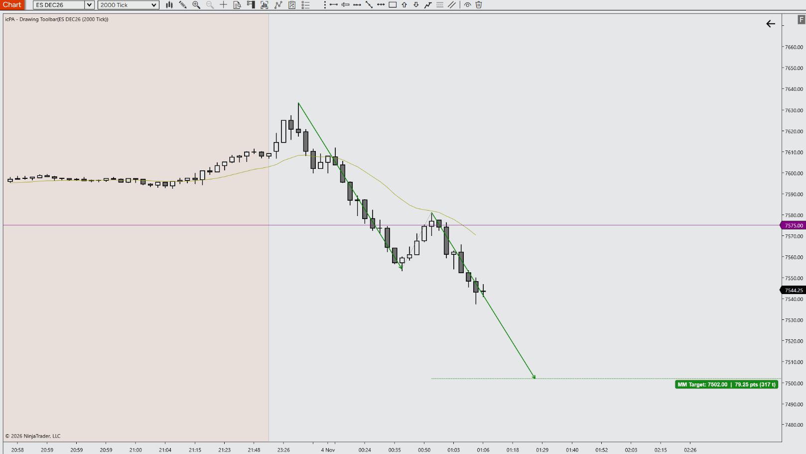

# Measured Move for NinjaTrader 8

A specialized Drawing Tool engineered for Price Action day trading. Three clicks mark leg 1 and the pullback, and the tool projects an equal leg 2 with the measured move target price drawn as a line and labeled badge.

---

## 📺 Video Walkthrough & Setup

Watch the complete breakdown of parameters, price action context, and chart examples on YouTube:

> **[▶ Click here to watch the full YouTube walkthrough](https://youtube.com/@icPriceAction)**

---

## ⚡ Key Features

- **Leg 1 = Leg 2 Projection:** Click the start and end of leg 1, then the pullback. The target is the pullback price plus leg 1's price distance, rounded to the instrument's tick size. Leg 2 and the target preview live while you place the pullback.
- **Adjustable Leg 2 Duration:** Drag the square handle on the arrowhead left or right to stretch or shorten leg 2 in time (0.1× to 10× leg 1). The target price never moves.
- **Target Line & Badge:** An optional horizontal target line extends to the right edge of the chart, with a badge showing the target price, leg size in points and ticks, and the time ratio when it is not 1×. The badge sits above the line on bullish moves and below it on bearish moves.
- **PATS & Context Aligned:** Designed for Price Action principles (Mack / Thomas Wade) and disciplined futures execution.
- **Zero Chart Lag:** Native C# execution optimized to prevent UI freezes on high-frequency 2000-tick ES/MES charts.
- **Clean Visuals:** Complementary default palette that preserves candlestick clarity without chart clutter.
- **Fully Customizable:** Configure colors, thresholds, offsets, and alerts via the native NT8 settings panel.

---

## ⚠️ Prerequisites & Data Requirements

- Works on any chart and bar type: time, tick, volume, range and Renko. No Tick Replay or market depth required.
- Leg 2's duration is measured in chart space, so it stays correct across session breaks and weekends on equidistant charts.
- Price formatting follows the chart instrument (futures, FX, fractional bonds).

---

## 📥 Installation Guide

1. Head to the **[Releases](https://github.com/icPriceAction/measured-move/releases)** tab of this repository.
2. Download the latest release `.zip` file (`icPriceAction_MeasuredMove_v1.2.1.zip`).
   - *Note: Do NOT extract or unzip the file.*
3. Open **NinjaTrader 8**.
4. In the Control Center, navigate to:
   `Tools` ➔ `Import` ➔ `NinjaScript Add-On...`
5. Select the downloaded `.zip` file and click **Open**.
6. A success dialog will appear confirming the tool has been imported.
7. Open any chart, open the Drawing Tools menu, and select **Measured Move**.

### How to Draw

1. **Click 1:** start of leg 1.
2. **Click 2:** end of leg 1.
3. **Click 3:** the pullback where leg 2 begins. The projection and target appear.
4. Select the tool to edit it. Drag any round handle to move that point (magnet mode is respected), drag the square arrowhead handle to change leg 2's duration, or drag a line or the badge to move the whole tool.

---

## ⚙️ Parameters & Configuration

| Parameter | Group | Type | Default | Description |
| :--- | :--- | :--- | :--- | :--- |
| Leg 2 time ratio | 1. General | Number (0.1 – 10) | 1.0 | Leg 2 duration relative to leg 1 (1 = same duration). Changes only the arrow's horizontal length, never the target price. Also set by dragging the arrowhead handle. |
| Draw horizontal target line | 1. General | True / False | True | Draws a horizontal line at the target price from the pullback to the right edge of the chart. When on, the badge is pinned to the right edge. |
| Legs | 2. Visuals | Stroke | Green, Solid, 2 px | Line style for leg 1 and the projected leg 2. |
| Retracement connector | 2. Visuals | Stroke | Gray (#717171), Dot, 1.25 px, 75% opacity | Line style for the connector from the end of leg 1 to the pullback. |
| Target line and badge | 2. Visuals | Stroke | Green, Dash, 1.2 px, 85% opacity | Line style for the target line. Its color is also used as the badge background. |
| Show target badge | 2. Visuals | True / False | True | Shows the label with the target price, leg size in points and ticks, and the time ratio when it is not 1. |
| Font | 2. Visuals | Font | Arial 11, Bold | Font used for the target badge text. |
| Text color | 2. Visuals | Color | White | Color of the target badge text. |

The three anchor points (Leg 1 start, Leg 1 end, Leg 2 start / pullback) can also be edited by price and time in the **Data** section of the properties window.

---

## 📝 Changelog

- **v1.2.1** (2026-11-03) - Initial public release. Cleaned and optimized by icPriceAction.
- **v1.2.0** (date unknown) - Time handle on the leg 2 arrowhead: drag to change leg 2 duration (Leg 2 Time Ratio); target price never changes.
- **v1.2.0** (date unknown) - Projection measured in chart space: works on tick/volume/range/Renko charts and across session breaks and weekends.
- **v1.2.0** (date unknown) - Leg 2 and the target previewed live while placing the pullback point; no phantom leg 2 while building.
- **v1.2.0** (date unknown) - Magnet mode respected when editing anchors; whole-tool move uses MoveAnchor.
- **v1.2.0** (date unknown) - Prices formatted and rounded per instrument (FX, fractional bonds, etc).
- **v1.2.0** (date unknown) - Badge sized to its text, kept inside the panel, placed below the line on bearish moves.
- **v1.2.0** (date unknown) - Locked tools can no longer enter edit mode.
- **v1.2.0** (date unknown) - Tool stays visible when its anchors scroll off-screen (target line extends right).
- **v1.2.0** (date unknown) - Standard NinjaTrader Stroke properties and font picker; antialiased rendering, cached text format, custom menu icon.

---

## ☕ Support the Project

All tools provided by **icPriceAction** are 100% free and open-source for personal trading use. These tools, even though supported by AI, have taken considerable time to design, build, test and package. If these tools bring you value, consider supporting continued development:

- **Prop Firm Traders:** Use discount code **`ICPAT`** at checkout across top futures prop evaluation firms ([View Active Discounts](https://icpriceaction.com/prop-firms.html)).
- **Profitable Traders:** Send a one-time tip to support my continued support and time, server hosting and open-source updates via [Buy Me a Coffee](https://buymeacoffee.com/icpriceaction).

---

## 🐛 Bug Reports & Feature Requests

Found an issue or have an enhancement idea?
Please submit an issue on the [Issues tab](https://github.com/icPriceAction/measured-move/issues).

---

## License

Free for personal trading use. Commercial resale, redistribution, or repackaging is strictly prohibited. See [LICENSE](LICENSE).

---

## ⚖️ Disclaimer

Futures trading involves substantial risk of loss and is not suitable for every investor. All indicators, drawing tools, strategies, and documentation provided by **icPriceAction** are for educational and analytical purposes only. Nothing herein constitutes financial or investment advice. Automated strategies can lose money and may behave differently in live markets than in simulation or backtests.

NinjaTrader® is a registered trademark of NinjaTrader, LLC. icPriceAction is an independent developer with no official affiliation to NinjaTrader, LLC.